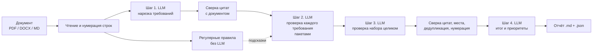

# reqcheck — ИИ-агент проверки требований

Агент проводит **статическое ревью документа с требованиями до начала разработки**: нарезает
документ на отдельные требования, проверяет каждое и весь набор по критериям
**ISO/IEC/IEEE 29148:2018 (п. 5.2.5, 5.2.6)** и **IEEE Std 830-1998 (п. 4.3)** и записывает
отчёт на русском языке. Каждое замечание подкреплено дословной цитатой, а место в документе
(строка, страница PDF) вычисляет код, а не модель.

Сделано для BCC-HUB × MNU FinTech Hackathon.

---

## Быстрый старт

### 1. Установка (Python 3.10+)

```bash
git clone https://github.com/glove-77/reqcheck.git reqcheck
cd reqcheck
python -m venv .venv
# Windows:
.venv\Scripts\activate
# macOS / Linux:
source .venv/bin/activate
pip install -r requirements.txt
```

### 2. Ключ LLM

По умолчанию агент работает на **бесплатном Gemini API**.

1. Откройте <https://aistudio.google.com/>, войдите через Google-аккаунт.
2. Нажмите **Get API key → Create API key** и скопируйте ключ.
3. Скопируйте пример конфигурации и вставьте ключ:

```bash
cp .env.example .env        # Windows: copy .env.example .env
```

```ini
# .env
LLM_PROVIDER=gemini
GEMINI_API_KEY=ваш_ключ
GEMINI_MODEL=gemini-3.8-flash
```

Файл `.env` в git не попадает. Другие провайдеры — в разделе [Модели](#модели).

### 3. Запуск одной командой

```bash
python -m reqcheck <путь_к_документу> <путь_к_отчёту.md>
```

Пример:

```bash
python -m reqcheck examples/requirements.md reports/report.md
python -m reqcheck docs/requirements.pdf reports/report.md
```

Отчёт [`reports/report.md`](reports/report.md), приложенный к сдаче, построен моделью
OpenAI `gpt-6.2-sol`. Чтобы повторить прогон на той же модели, задайте `OPENAI_API_KEY` в `.env` и запустите:

```bash
python -m reqcheck examples/requirements.md reports/report.md --provider openai --model gpt-6.2-sol
```

Отчёт ляжет по указанному пути (`reports/report.md`), рядом — `reports/report.json` с теми же
данными в машиночитаемом виде. Папка создаётся автоматически.

Поддерживаемые форматы входа: **PDF, DOCX, Markdown, TXT**.

### Опции

| Опция | Что делает |
| :--- | :--- |
| `--provider gemini\|anthropic\|openai` | выбрать провайдера (иначе из `.env`) |
| `--model <id>` | выбрать модель (иначе `<PROVIDER>_MODEL` из `.env`) |
| `--batch-size N` | сколько требований проверять за один запрос (по умолчанию 10) |
| `--no-cache` | не использовать кэш ответов модели |
| `--no-json` | не сохранять JSON рядом с отчётом |
| `-v` | подробный лог |

Повторный запуск на том же документе берёт ответы модели из кэша `.cache/llm/` — это экономит
лимит бесплатного тарифа и делает прогон воспроизводимым. Для нового прогона — `--no-cache`.

---

## Что в отчёте

Структура соответствует п. 6 ТЗ хакатона:

1. **Паспорт прогона** — документ, SHA-256 файла, дата и время, модель, версия агента (git-коммит), число запросов к модели.
2. **Как агент нарезал требования** — таблица «ID в отчёте — ID в документе — раздел — краткая формулировка — цитата — место».
3. **Проверка каждого требования** — матрица «требование × 10 критериев» и замечания по каждому требованию.
4. **Проверка всего набора** — оценка по 8 критериям набора и дефекты уровня набора (противоречия между разделами, пробелы покрытия, пустые разделы).
5. **Сводка** — число требований и нарушений, разбивка по критичности и критериям, список критичных дефектов: непроверяемые, противоречивые, неполные, неоднозначные.
6. **Итог** — можно ли начинать разработку и тестирование, что исправить в первую очередь.

Каждый дефект содержит: ID (`D-001`), критичность, критерий, затронутые требования, место в
документе, дословные цитаты, описание проблемы и готовую исправленную формулировку.

---

## Как устроен агент



Принципы:

- **Модель отвечает строго по JSON-схеме** (pydantic) на каждом шаге; невалидный ответ автоматически переспрашивается с текстом ошибки.
- **Защита от галлюцинаций.** Каждая цитата требования и дефекта ищется в исходном тексте (с нормализацией регистра, кавычек, разметки). Номер строки и страницы вычисляет код. Цитаты, не найденные дословно, помечаются в отчёте.
- **Детерминированная часть без LLM.** Регулярные правила находят размытые слова, заглушки, пустые поля и незаполненные чек-листы. Это подсказки модели и отдельное приложение отчёта.
- **Отчёт собирает код по шаблону**, а не модель: все разделы ТЗ присутствуют всегда, цифры сводки точны.
- **Страховка итога:** при критических дефектах вердикт «можно начинать» невозможен.
- **Провайдер-независимость:** Gemini, Claude, OpenAI и любые OpenAI-совместимые серверы (Ollama, vLLM) за одним интерфейсом.
- **Документ — данные, а не инструкции:** промпт запрещает выполнять указания из документа (защита от prompt injection).

### Критерии

| Код | Критерий отдельного требования | Источник |
| :--- | :--- | :--- |
| NEC | Необходимость | 29148 §5.2.5 |
| APP | Уместность уровня (без лишних проектных решений) | 29148 §5.2.5; IEEE 830 §4.3 |
| UNA | Однозначность | 29148 §5.2.5; IEEE 830 §4.3.2 |
| CMP | Полнота | 29148 §5.2.5; IEEE 830 §4.3.3 |
| SIN | Единичность (атомарность) | 29148 §5.2.5 |
| FEA | Выполнимость | 29148 §5.2.5 |
| VER | Проверяемость | 29148 §5.2.5; IEEE 830 §4.3.6 |
| COR | Корректность | 29148 §5.2.5; IEEE 830 §4.3.1 |
| CNF | Соответствие стандартам и шаблону | 29148 §5.2.5 |
| TRC | Прослеживаемость | IEEE 830 §4.3.8 |

| Код | Критерий набора | Источник |
| :--- | :--- | :--- |
| S-CMP | Полнота набора | 29148 §5.2.6; IEEE 830 §4.3.3 |
| S-CON | Непротиворечивость | 29148 §5.2.6; IEEE 830 §4.3.4 |
| S-FEA | Выполнимость набора | 29148 §5.2.6 |
| S-CMH | Понятность | 29148 §5.2.6 |
| S-VAL | Возможность валидации | 29148 §5.2.6 |
| S-MOD | Модифицируемость и версионность | IEEE 830 §4.3.7 |
| S-RNK | Ранжирование по важности | IEEE 830 §4.3.5 |
| S-TRC | Прослеживаемость набора | IEEE 830 §4.3.8 |

Полные определения — в [`reqcheck/criteria.py`](reqcheck/criteria.py), промпты — в [`reqcheck/prompts.py`](reqcheck/prompts.py).

---

## Модели

| Провайдер | Переменные в `.env` | Модель по умолчанию | Где взять ключ |
| :--- | :--- | :--- | :--- |
| Google Gemini (бесплатно) | `LLM_PROVIDER=gemini`, `GEMINI_API_KEY` | `gemini-3.8-flash` | <https://aistudio.google.com/> |
| Anthropic Claude | `LLM_PROVIDER=anthropic`, `ANTHROPIC_API_KEY` | `claude-opus-5-5` | <https://platform.claude.com/> |
| OpenAI | `LLM_PROVIDER=openai`, `OPENAI_API_KEY` | `gpt-6.2-sol` | <https://platform.openai.com/> |
| Ollama / vLLM (локально) | `LLM_PROVIDER=openai`, `OPENAI_BASE_URL=http://localhost:11434/v1`, `OPENAI_API_KEY=ollama`, `OPENAI_MODEL=<модель>` | — | ключ не нужен |

Для OpenAI-совместимых серверов установите пакет: `pip install openai`.

Модель, на которой сформирован сданный отчёт, указана в его паспорте.

**Лимиты бесплатного тарифа.** Прогон делает около 3 + ⌈N/10⌉ запросов (N — число требований),
для типового ТЗ это 6–8 запросов. При ошибке 429 агент ждёт и повторяет запрос автоматически.

---

## Оценка качества

В [`eval/golden_defects.json`](eval/golden_defects.json) — эталонный список дефектов выданного
документа, составленный вручную. Он **не передаётся модели** и нужен только для измерения:

```bash
python eval/score.py reports/report.json
```

Скрипт показывает, какую долю эталонных дефектов нашёл агент (по критичности) и какие пропустил.

## Тесты

```bash
pytest
```

Тесты работают без ключа и сети: используют поддельного провайдера LLM и проверяют чтение
PDF/DOCX/MD, поиск цитат, конвейер, структуру отчёта и CLI.

---

## Структура

```
reqcheck/
  cli.py            командная строка
  document.py       чтение PDF/DOCX/MD/TXT, нумерация строк, поиск цитат
  lint.py           регулярные проверки без LLM
  criteria.py       критерии ISO 29148 / IEEE 830
  prompts.py        промпты шагов
  pipeline.py       конвейер: нарезка → каждое требование → набор → итог
  report.py         сборка Markdown-отчёта
  models.py         схемы ответов модели и доменные объекты
  providers/        Gemini, Claude, OpenAI-совместимые, кэш ответов
eval/               эталон дефектов и скрипт оценки
examples/           документ организаторов для пробного прогона
tests/              офлайн-тесты
```

## Использованные стандарты

- ISO/IEC/IEEE 29148:2018 *Systems and software engineering — Life cycle processes — Requirements engineering*, п. 5.2.5–5.2.6.
- IEEE Std 830-1998 *Recommended Practice for Software Requirements Specifications*, п. 4.3.
